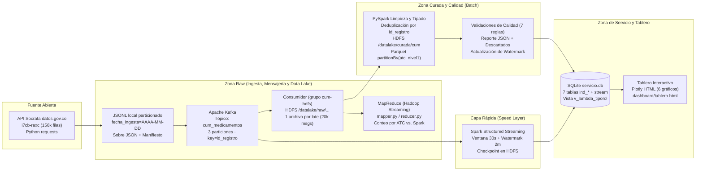

# Pipeline de Datos Masivos: Código Único de Medicamentos Vigentes (CUM - INVIMA)

**Institución Universitaria Pascual Bravo · Gestión de Datos Masivos G002 · 2026-2**  
**Docente:** Aleixo Eder Pineda Ramirez  
**Integrantes:** Martín Sánchez Urrego · Samuel Montoya Garzón  

---

## 1. Fuente, Pregunta y Arquitectura (Fase 1)

### Fuente de datos
| Aspecto | Detalle |
|---|---|
| **Dataset** | Código Único de Medicamentos (CUM) Vigentes — INVIMA |
| **Portal / API** | Datos Abiertos Colombia (`datos.gov.co`, API Socrata SODA): [`https://www.datos.gov.co/resource/i7cb-raxc.json`](https://www.datos.gov.co/resource/i7cb-raxc.json) |
| **Volumen** | **156.281 registros** (supera el mínimo exigido de 20.000 registros) |
| **Columnas de fecha** | `fechaexpedicion`, `fechavencimiento`, `fechaactivo`, `fechainactivo` (en formato texto `MM/DD/YYYY` en la fuente) |
| **Definición de `id_registro`** | Campo de sistema de Socrata **`:id`** (ej. `row-umgd~agp9~tz66`), único por fila. **Justificación:** el dataset está desnormalizado a nivel de *CUM × principio activo × rol (fabricante/importador)* y ni siquiera la combinación `expedientecum + consecutivocum + principioactivo + nombrerol + tiporol` es única (presenta hasta 10 repeticiones legítimas por variantes de concentración o planta). Como respaldo ante ausencia de `:id`, se calcula el hash `SHA-256` del payload JSON ordenado. |
| **Marca de agua (Watermark)** | Campo de sistema **`:updated_at`** (`$where=:updated_at > '<watermark>'`), que permite traer únicamente registros nuevos o modificados en cargas incrementales. |

### Pregunta principal y usuarios
> **¿Cómo está compuesta y cómo ha evolucionado la oferta de medicamentos con registro sanitario vigente en Colombia (por grupo terapéutico ATC, vía de administración y origen fabricante vs. importador), y qué tanto depende el país de importaciones y de pocos titulares?**

- **¿Quién usaría estos indicadores?**
  1. **Ministerio de Salud y Protección Social / INVIMA:** para vigilar el riesgo de desabastecimiento en grupos terapéuticos críticos con alta dependencia de importación o alta concentración en pocos titulares.
  2. **EPS, IPS y operadores logísticos:** para planificar compras, negociaciones y sustitución terapéutica por principio activo y forma farmacéutica.
  3. **Cadenas de droguerías y laboratorios farmacéuticos:** para identificar brechas de mercado por grupo ATC y vía de administración.

### Diagrama de arquitectura por zonas (`raw → curada → servicio`)



### ¿Arquitectura Lambda o Kappa?
Elegimos **Arquitectura Lambda**:
- **Capa Batch (vía HDFS → PySpark → Parquet → SQLite):** la fuente de `datos.gov.co` es un padrón regulatorio que se consulta por lotes mediante API REST y requiere deduplicación global por `id_registro`, normalización de razones sociales, conversión de fechas `MM/DD/YYYY` y cruces a nivel de presentación comercial (`cum_id = expedientecum-consecutivocum`). La capa batch garantiza exactitud e integridad completa.
- **Capa Rápida / Speed Layer (vía Kafka → Spark Structured Streaming → SQLite):** procesa en tiempo real los mensajes que ingresan al tópico `cum_medicamentos` con agregaciones por ventana de 30 segundos, *watermark* de 2 minutos y *checkpoint* en HDFS, alimentando la tabla `stream_conteos_ventana`.
- **Unión en la Zona de Servicio:** la vista `v_lambda_tiporol` en SQLite une los conteos exactos de la capa batch (`ind_registros_tiporol`) con los conteos de baja latencia de la capa de streaming (`stream_conteos_ventana`), permitiendo contrastar ambas capas en el tablero.

---

## 2. Decisiones Técnicas por Fase (Fases 2 a 8)

### Fase 2 — Ingesta a la zona raw (`src/01_ingesta.py`)
- **Paginación estable:** consulta con `$select=*,:id,:created_at,:updated_at`, `$limit=50000`, `$offset` incremental y `$order=:id` para evitar duplicados o saltos entre páginas.
- **Tolerancia a fallos:** sesión HTTP con hasta 5 reintentos y espera exponencial (*exponential backoff*: 2s, 4s, 8s, 16s, 32s) ante errores transitorios (`429`, `500`, `502`, `503`, `504`, `Timeout`, `ConnectionError`).
- **Sobre JSON (*envelope*):** cada fila se envuelve sin alterar un solo carácter del registro original en `payload`:
  ```json
  {
    "fuente": "datos.gov.co",
    "dataset": "i7cb-raxc",
    "id_registro": "row-umgd~agp9~tz66",
    "fecha_ingesta": "2026-11-21",
    "ts_ingesta": "2026-11-21T14:25:00-05:00",
    "run_id": "20261121T142500",
    "payload": { "...registro original intacto..." }
  }
  ```
- **Particionamiento y manifiesto:** salida en `data/raw/datos.gov.co/i7cb-raxc/fecha_ingesta=AAAA-MM-DD/run_<id>.jsonl` y manifiesto en `data/manifiestos/manifest_<id>.json` con URL, parámetros, páginas, conteo de registros y marca de agua.

### Fase 3 — Mensajería con Apache Kafka (`src/02_productor.py` y `src/03_consumidor_hdfs.py`)
- **Tópico:** `cum_medicamentos` con **3 particiones** y factor de replicación 1.
- **Productor:** publica cada línea JSONL con `key = id_registro` (garantiza que todas las versiones de un mismo registro vayan siempre a la misma partición en orden).
- **Consumidor:** grupo `cum-hdfs` con `enable.auto.commit=False`; hace *commit* sincrónico de offsets únicamente después de escribir cada lote en HDFS.
- **¿Qué pasa si el productor se ejecuta dos veces y cómo evitamos duplicados?**
  1. En el broker: `enable.idempotence=True` y `acks=all` evitan duplicados por reintentos de red entre productor y broker.
  2. En el productor: el archivo `data/state/archivos_publicados.json` registra los lotes JSONL ya enviados; si se ejecuta una segunda vez, omite los archivos ya publicados.
  3. En el pipeline completo: como Kafka ofrece entrega *al menos una vez* (*at-least-once*), si se forzara la republicación (`--forzar`) o un consumidor releyera un lote tras una caída previa al commit, la **Fase 5 deduplica en PySpark por `id_registro`** conservando el `:updated_at` más reciente, y la **Fase 7 usa checkpoint y UPSERT por llave primaria** en SQLite.

### Fase 4 — Data Lake en HDFS y MapReduce (`src/03_consumidor_hdfs.py` y `src/04_mapreduce.py`)
- **Escritura por lotes en HDFS:** el consumidor agrupa de a **20.000 mensajes por archivo** (`lote_<ts>_0001.jsonl`) dentro de `/datalake/raw/datos.gov.co/i7cb-raxc/fecha_ingesta=AAAA-MM-DD/`, evitando el problema de *small files* en el NameNode.
- **MapReduce vs. Spark:** `src/mapreduce/mapper.py` extrae la primera letra del código ATC (`A`..`V` o `SIN_ATC`) y emite `<grupo>\t1`; `reducer.py` totaliza por grupo. `src/04_mapreduce.py` ejecuta Hadoop Streaming sobre HDFS, repite el mismo cálculo en PySpark y verifica automáticamente que todas las claves y el total coincidan 100 %.

### Fase 5 — Zona curada con PySpark (`src/05_curada_spark.py`)
Cada transformación registra el conteo antes y después en `evidencias/curada_pasos.json`:

| Paso | Problema en el dato crudo | Decisión tomada y justificación |
|---|---|---|
| **1. Columnas clave** | Posibles registros sin `id_registro`, `expediente` o `consecutivocum` | Se filtran y se envían a `/datalake/descartados/cum` con el motivo `sin_columnas_clave`. Sin estas llaves no se puede identificar ni agrupar el CUM. |
| **2. Duplicados** | Reingestas o republicaciones en Kafka del mismo `id_registro` | Ventana `Window.partitionBy("id_registro").orderBy(actualizado_fuente.desc(), ts_ingesta.desc())` conservando `row_number() == 1`. Los duplicados van a `/datalake/descartados/cum`. |
| **3. Texto inconsistente** | Espacios dobles, minúsculas/mayúsculas mezcladas, tildes en categorías y variantes societarias (`S. A.`, `S.A.S`) | `trim`, colapso de espacios múltiples, `UPPER`, eliminación de tildes en campos categóricos, estandarización de `S.A.` / `S.A.S.` y conversión de `muestramedica` (`SI`/`NO`) a booleano `es_muestra_medica`. |
| **4. Fechas como texto** | `fechaexpedicion`, `fechavencimiento`, `fechaactivo` y `fechainactivo` vienen en formato texto `MM/DD/YYYY` | Conversión con `to_date(..., "M/d/yyyy")`. Fechas de expedición/activación/inactivación futuras imposibles (`> current_date()`) se anulan (`NULL`) sin borrar la fila porque el resto del registro sanitario es válido. |
| **5. Números como texto** | `expediente`, `expedientecum`, `consecutivocum`, `cantidadcum` y `cantidad` llegan como strings | Cast a `long` (identificadores/consecutivos) y `double` (cantidades). Cantidades negativas se limpian a `NULL`. |
| **6. Tratamiento de nulos** | Nulos en `fechainactivo` (~118 mil filas) y posibles nulos en categorías (`atc`, `viaadministracion`, `formafarmaceutica`, `tiporol`) | **`fechainactivo` nula SE CONSERVA** porque indica que el CUM sigue activo. En variables categóricas de agrupación los nulos se imputan como `'NO REPORTA'` para no perder presentaciones en los totales. |
| **7. Columnas derivadas** | Se requieren llaves analíticas para el tablero | Se crean `atc_nivel1` (letra ATC validada con regex `^[ABCDGHJLMNPRSV][0-9]{2}`), `grupo_atc` (nombre OMS), `cum_id` (`expedientecum-consecutivocum`), `anio_expedicion`, `es_activo` y `es_importador`. |

- **Justificación de la partición Parquet (`partitionBy("atc_nivel1")`):** `atc_nivel1` tiene **baja cardinalidad (14 grupos terapéuticos OMS + `SIN_ATC`)**, distribuye los archivos de forma equilibrada y coincide con el filtro principal de las consultas analíticas (*partition pruning*). Particionar por `expediente` (9.500 carpetas) causaría *small files*, y por `fecha_ingesta` concentraría todo el padrón inicial en una sola carpeta.
- **Compresión Parquet vs. JSONL:** se guarda en `evidencias/curada_tamanos.json` la comparación de tamaño entre el JSONL crudo y el Parquet con compresión Snappy (reducción ~85–90 %).

### Fase 6 — Calidad, carga incremental e idempotencia (`src/calidad.py` y `src/run_pipeline.py`)
- **7 validaciones automáticas** (las 3 críticas detienen el pipeline con `CalidadError` antes de escribir Parquet o mover el watermark):
  1. **[Crítica]** `conteo_mayor_que_cero`: el DataFrame curado no puede estar vacío.
  2. **[Crítica]** `sin_nulos_en_columnas_clave`: 0 nulos en `id_registro`, `expediente`, `consecutivocum`.
  3. **[Crítica]** `id_registro_sin_repetidos`: unicidad total de `id_registro` tras la limpieza.
  4. **[Advertencia]** `cantidades_en_rango`: `cantidad >= 0` y `cantidadcum > 0`.
  5. **[Advertencia]** `fechaexpedicion_en_rango`: entre `1950-01-01` y la fecha actual.
  6. **[Advertencia]** `estadocum_en_dominio`: valores dentro de `{'Activo', 'Inactivo'}`.
  7. **[Advertencia]** `coherencia_estado_fechainactivo`: registros con `estadocum = 'Activo'` que conservan una `fechainactivo` histórica (reactivaciones en el INVIMA).
- **Idempotencia:** la marca de agua (`data/state/watermark.json`) solo se actualiza al finalizar con éxito la Fase 5. Si `run_pipeline.py` se ejecuta dos veces seguidas, la segunda corrida descarga 0 registros nuevos, publica 0 mensajes en Kafka y mantiene exactamente los mismos conteos en raw, curada y servicio (`evidencias/idempotencia_corridas.jsonl`).

### Fase 7 — Streaming: capa rápida (`src/06_streaming.py`)
- Lee el tópico `cum_medicamentos` desde Spark Structured Streaming, extrae el timestamp del mensaje en Kafka (`ts_kafka`) y el `tiporol`, y calcula el conteo por **ventana de 30 segundos** (`F.window("ts_kafka", "30 seconds")`) con **`withWatermark("ts_kafka", "2 minutes")`** y **`checkpointLocation` en HDFS** (`/checkpoints/cum_stream`).
- Usa `foreachBatch` con `INSERT ... ON CONFLICT(ventana_inicio, tiporol) DO UPDATE` hacia SQLite (`stream_conteos_ventana`) y `trigger(availableNow=True)`.
- **Evidencia de reinicio sin duplicación:** al ejecutar `06_streaming.py` una segunda vez sobre el mismo checkpoint, Spark lee los offsets ya confirmados en `/checkpoints/cum_stream`, procesa `0` mensajes nuevos y la suma de mensajes en `stream_conteos_ventana` permanece intacta (`evidencias/streaming_reinicio.json`).

### Fase 8 — Zona de servicio y tablero (`src/07_servicio.py` y `src/08_tablero.py`)
- **Base de servicio (`data/servicio/servicio.db` en SQLite):**
  1. `ind_resumen`: KPIs globales, porcentaje importado, concentración top 10, fuente y fecha de corte.
  2. `ind_atc_estado`: CUM activos, inactivos y totales por grupo terapéutico ATC nivel 1.
  3. `ind_origen_atc`: dependencia de importación (`% CUM activos con rol importador`) por grupo ATC.
  4. `ind_top_titulares`: top 15 titulares con mayor número de CUM activos, participación y acumulado.
  5. `ind_evolucion_anual`: registros sanitarios expedidos y CUM inactivados por año (`>= 1990`).
  6. `ind_via_administracion`: CUM activos por vía de administración.
  7. `ind_registros_tiporol`, `stream_conteos_ventana` y la vista **`v_lambda_tiporol`** (unión batch + streaming).
- **Tablero (`dashboard/tablero.html` y `docs/index.html`):** archivo HTML autocontenido con Plotly que lee exclusivamente de `servicio.db`, incluye 6 tarjetas de KPI, 6 visualizaciones interactivas, título analítico que responde la pregunta, fuente y fecha de corte.

---

## 3. Estructura del Repositorio

```text
pp-cum-invima/
├── README.md                          # Documentación completa del proyecto
├── requirements.txt                   # Dependencias de Python
├── setup_colab.sh                     # Instala y arranca Java 11, Kafka (KRaft) y HDFS en Colab
├── notebooks/
│   └── pipeline_cum_colab.ipynb       # Notebook autocontenido con las fases 2 a 8
├── src/
│   ├── config.py                      # Parámetros, rutas locales y HDFS, grupos ATC
│   ├── utils.py                       # Helpers JSON, CLI de HDFS y guardado de evidencias
│   ├── spark_utils.py                 # Sesión de PySpark y esquema del sobre raw
│   ├── 01_ingesta.py                  # Fase 2: API Socrata -> JSONL raw + manifiesto
│   ├── 02_productor.py                # Fase 3: JSONL raw -> tópico Kafka (3 particiones)
│   ├── 03_consumidor_hdfs.py          # Fase 3/4: consumidor Kafka -> lotes en HDFS
│   ├── 04_mapreduce.py                # Fase 4: Hadoop Streaming vs. Spark
│   ├── mapreduce/
│   │   ├── mapper.py                  # Mapper en Python (grupo ATC nivel 1)
│   │   └── reducer.py                 # Reducer en Python (suma por grupo ATC)
│   ├── calidad.py                     # Fase 6: 7 reglas de calidad y parada ante fallo crítico
│   ├── 05_curada_spark.py             # Fase 5/6: limpieza PySpark, calidad, Parquet y watermark
│   ├── 06_streaming.py                # Fase 7: Structured Streaming con ventana, watermark y checkpoint
│   ├── 07_servicio.py                 # Fase 8a: cálculo de indicadores hacia SQLite
│   ├── 08_tablero.py                  # Fase 8b: generación del tablero Plotly HTML
│   └── run_pipeline.py                # Orquestador extremo a extremo y prueba de idempotencia
├── dashboard/
│   └── tablero.html                   # Tablero interactivo final
├── docs/
│   └── index.html                     # Copia del tablero lista para GitHub Pages
├── data/
│   ├── muestra_raw/                   # Muestra de 1.000 líneas del sobre JSONL raw
│   ├── manifiestos/                   # Manifiestos JSON de ingesta
│   ├── calidad/                       # Reportes JSON de validaciones de calidad
│   └── servicio/                      # Base SQLite servicio.db y exportación CSV de indicadores
└── evidencias/                        # Salidas de Kafka, HDFS, MapReduce, idempotencia y streaming
```

---

## 4. Cómo Ejecutar el Pipeline Paso a Paso

### Opción A — En Google Colab (recomendada)
1. Subir el archivo `notebooks/pipeline_cum_colab.ipynb` a [Google Colab](https://colab.research.google.com/).
2. Ejecutar todas las celdas en orden (`Entorno de ejecución → Ejecutar todas`).
   - La sección **0** instala Java 11, Apache Kafka 3.7 (modo KRaft) y Hadoop 3.3.6 (HDFS pseudo-distribuido).
   - Las secciones **Fase 2 a Fase 8** crean cada script, ejecutan el pipeline real contra la API del INVIMA, muestran el tablero dentro del notebook y descargan `entrega_pp.zip` con todas las evidencias, manifiestos, base SQLite y tablero HTML.

### Opción B — Por línea de comandos (Linux / WSL / contenedor con Kafka y HDFS)
```bash
# 1. Levantar Kafka y HDFS e instalar librerías
bash setup_colab.sh
pip install -r requirements.txt

# 2. Ejecutar el pipeline completo (primera corrida)
python src/run_pipeline.py --etiqueta corrida_1

# 3. Ejecutar por segunda vez para demostrar idempotencia (0 duplicados)
python src/run_pipeline.py --etiqueta corrida_2

# 4. (Opcional) Demostrar parada automática ante fallo crítico de calidad
PP_SIMULAR_FALLO=1 python src/run_pipeline.py --etiqueta fallo_simulado --sin-mapreduce
```

